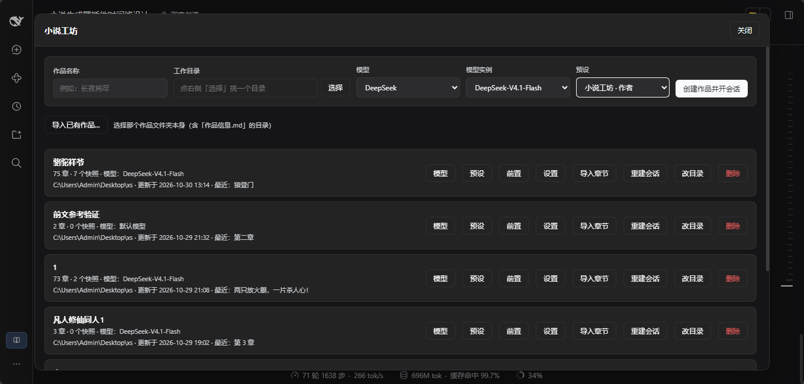
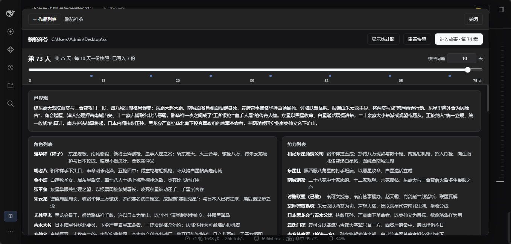
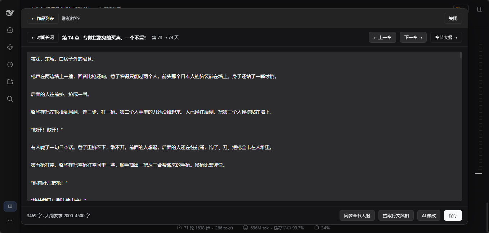
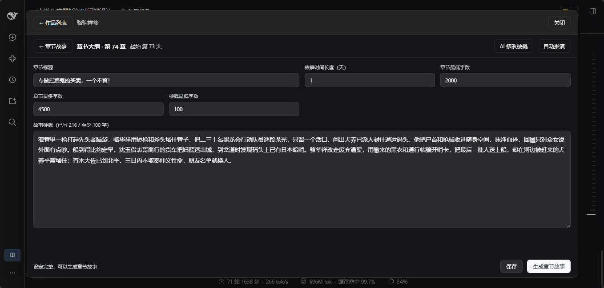

# 小说工坊 · dsh-novel-generator

DSH 的常驻插件：在时间线上写小说。每个作品绑定一个普通会话，章节正文与世界快照都由那个会话里自己的 Agent 生成。

## 截图

作品列表（每行「模型 / 预设 / 前置 / 设置 / 导入章节 / 重建会话 / 改目录 / 删除」）：



时间长河与世界快照：



章节故事页（编辑、同步章节大纲、提取行文风格、AI 修改）：



章节大纲页（梗概、字数范围、时间长度、AI 修改梗概）：



> 这四张也在 `screenshots.json` 里声明了顺序，插件市场详情页会按这个顺序展示。

## 安装

```sh
dsh plugin --profile web add dsh-novel-generator
# 或直接装这个仓库：dsh plugin --profile web add https://github.com/XiaoOu2024/dsh-novel-generator
```

或在 DSH 的 **设置 → 插件** 里安装（本包声明了 `dsh.bundle`）。装好后刷新页面，界面左下角出现「小说工坊」按钮。

> npm 包名 `dsh-novel-generator` 与 GitHub 仓库 `XiaoOu2024/dsh-novel-generator` 同名。

需要 **DeepSeek Harness 0.2.1-rc.2 或更新的 0.2.x**：宿主侧调用 `sessionController`（create / selectModel / prompt / resolveAgent）、`workspaceRegistry`（create / resolveByPath / attachSession）与 `agentPresets`，这些在 0.2.1 之前不存在或不稳定。`package.json` 里以 `peerDependencies: { "@deepseek-ai/dsh": "^0.2.1-rc.2" }`（optional）声明，安装环境与本机验证版本一致。

## 打开方式

界面左下角（设置按钮旁）的 **小说工坊** 按钮，点开就是项目管理界面；右上角「关闭」退出。

## 界面流程

1. **作品列表**：创建 / 删除 / 打开作品。**删除作品会同时删掉工作目录下以作品名命名的那个文件夹（正文、梗概、快照），二次确认里会说明；作品绑定的会话保留。**创建时选工作目录、模型、预设——**工作目录只能通过「选择」调目录选择器挑选，不能手填**；创建动作本身会调用 `sessionController.create` 为作品开一个会话，会话照常出现在左侧列表里，可以直接进去对话。**每行都显示当前模型，并有「模型」按钮：改完会同时切换作品绑定的会话模型**（走 `sessionController.selectModel`）。**会话会被放进左侧对应的分组：作品目录已经是工作区就并进去，否则为该目录新建一个名为「小说工坊」的工作区**，不再是「未分组」。打开工作室时会对老作品补做这一步。
2. **时间长河**（作品主界面）：最上方是时间线，左端是第 0 天，右端是**最新世界快照的时间**（故事已经写到快照之后时，右端延伸到故事当前的时间）。拖动时下方世界观、角色列表、势力列表、关系（`甲 乙 关系`）切换到该时间点之前最新的那份快照。右上角「快照间隔」是一个可编辑的选择框：候选值 **7 / 15 / 30 / 90 / 180 / 365 天**，也可以直接输入别的天数——这个值同时是「多少天结算一份世界快照」的阈值和自动触发点。**拖到下一个快照点时，页面顶部出现「生成世界快照 · 第 N 天」按钮；拖到最新那份快照所在的那天，则出现「重新生成快照 · 第 N 天」（用于改过章节之后刷新这一版快照，会替换旧的那份）。两种情况都会先弹确认再执行。**「进入故事」进入离选中时间最近的章节。界面最底部是一条**每章天数统计图**：横轴为第几章（每章居中占一格），纵轴就是「今天数」——每章自己跨了多少天，柱高即该章天数，折线连接各章天数，鼠标悬停可看到该章在故事里的起止天数；标题栏的「隐藏统计图 / 显示统计图」按钮可以收起或展开它。
3. **章节故事**：左上「← 时间长河」回时间线界面，右上「章节大纲 →」把故事页向左收起、翻开大纲页。中间用「← 上一章 / 下一章 →」左右切换；**到了最后一章，右侧的「下一章 →」变成「＋ 新建章节」**。正文可直接改，底部「保存」，保存成功用右上角的提示条告知（不是页面上的一行小字）。**正文有未保存的修改时，任何离开动作（回时间线、翻章、进大纲、新建章节、返回作品列表、关闭工作室）都会先弹出确认，可选「不保存离开」或「保存并离开」。**
4. **新建章节**（弹窗）：章节名称（可留空）、章节最低字数、章节最多字数、故事时间长度（天），后三项必填。填好后可以「创建空章节」，或点「自动推演」一次拿到本章梗概、章节名称与完整正文。**作品的第一章没有世界快照、也没有上一章可依据，所以这一章的自动推演是禁用的（新建弹窗与章节大纲页都是），先创建空章节、自己写梗概再生成。**
5. **章节大纲**：左上「← 章节故事」。可改标题、时间长度、字数上下限、梗概最低字数与梗概；梗概达到最低字数且其他项填完才能「保存」，保存成功用提示条告知，保存后「生成章节故事」才可点。右上「自动推演」点下去会先提示「将覆盖现有内容」，确认后按当前字数与时间长度重新生成**故事梗概 + 章节名称 + 整章正文**并直接保存；「生成章节故事」点下去会先问「是否以当前故事梗概生成故事」，确认后才重写正文。**大纲有未保存的修改时，离开同样会先弹确认（不保存离开 / 保存并离开）；大纲不完整时「保存并离开」会拒绝并提示。**

## 世界快照怎么来

- 时间线以「天」计（0 = 创建作品那天），你选的「快照间隔」（7 / 15 / 30 / 90 / 180 / 365 天，可手输）决定了一条**网格**：第 15、30、45… 天。
- **手动**：把时间线拖到网格点上（第 N 天且 N 能被间隔整除），标题栏出现「生成世界快照 · 第 N 天」；该点已有快照时按钮变成「重新生成快照 · 第 N 天」，会替换旧的那份。两种情况都先弹确认。
- **自动**：只要故事时间被推进到新的网格点就会触发——**新建章节（含只有大纲的空章节）、自动推演、生成正文、手动保存正文**都算。判定是幂等的：已经存在的点不会被普通保存再次生成。
- **每个点收录哪些章节**（`[上一份快照日, 本点)` 半开区间）：
  - 只收录**结束时间严格早于本点**的章节——**结束在本点那一天的那一章不算**，它正是这次快照要"为之而拍"的那段，快照生成时它还没写出来；
  - 也不收录上一份快照已经收录过的章节（`结束日 < 上一快照日` 的跳过），所以**每一章恰好被一份快照收录一次**。
  - 例：间隔 30、章节各 10 天 → 第 30 天快照收录第 1、2 章；第 60 天快照收录第 3、4、5 章。
- 这样改间隔不会把旧快照重排：网格随当前间隔移动，自动生成只沿着链条向前推进，断档的地方留给你手动补。
- **空段落点不调用模型**：如果某个网格点没有可收录的章节（例如一章就占满整个间隔），插件直接把上一版快照抄过来、注明"这段时间没有已写章节"，既省一次模型调用，也避免模型凭空编出世界设定——那种编造会污染后续所有章节的提示。落点那一章不会因此丢失：写下一章时它照样出现在「已发生的章节梗概」里。
- 同一部作品同一时间只跑一个快照任务，避免并发把同一个点重复生成。

- **重置**：时间线右上角的「重置快照」会清空全部快照，再按当前间隔从第 1 格逐格重建到故事末端（确认框里写明要生成几份）。
- **物品 / 事件**：快照里除了世界观、角色、势力、关系，还有物品（名称 + 下落/用途）和事件（故事天数 + 标题 + 一句话），事件按时间从新到旧排列。
- **生成依据（统一规则）**：先找本章之前最近的那份世界快照。若「本章起始日 − 快照落点 > 当前间隔」，判定快照过旧，直接拒绝并提示先去时间长河更新快照；否则自动推演用「最近快照 + 快照落点之后、本章之前各章梗概」，写正文在此基础上再加一段「待生成的本章梗概」，并在提示里区分已发生与待生成两部分。

> 侧栏分组：DSH 的分组按目录归属，一个分组只收同目录下的会话，所以不同工作目录的作品会各有一个「小说工坊 · 目录名」分组；空分组与临时目录下的残留分组会被自动清理。


- **索引文件**：`<DSH_HOME>/novel-studio/projects/<项目id>/project.json`（`DSH_HOME` 缺省为 `~/.dsh`，本机即 `C:\Users\Admin\.dsh\novel-studio`）。时间线、大纲、快照字段都记在这里；`dataDir` 配置可改这块的位置。
- **正文、梗概、快照全部写到工作目录下、以作品名称命名的文件夹里**：

  ```
  <工作目录>/<作品名称>/
  ├── 作品信息.md                    作品参数总览 + 章节一览表
  ├── 第01章 章节名.md                章节正文（纯正文）
  ├── 章节大纲/
  │   └── 第01章 章节名.md            该章梗概 + 时间跨度 + 字数上下限 + 实际字数
  │   └── .history/                  梗概被改短的旧版本（每章最多留 5 份）
  └── 世界快照/
      └── 第030天.md                 世界观 / 角色 / 势力 / 关系 / 物品 / 事件 / 阶段变化
  ```

  - 每次保存正文、生成章节、保存大纲（改标题）、结算快照都会同步刷新这些文件；改标题会顺手删掉旧文件名。
  - 若你在编辑器里直接改章节正文 `.md` 且比插件记录的更新时间更晚，下次打开作品会以文件内容为准（梗概与快照目前是单向导出）。
  - **梗概是自由文本，可以自带 Markdown 小标题**：大纲卡片里 `## 故事梗概` 之后直到文件结尾都算梗概正文。若某次保存把梗概改短了，旧版本会先落到 `章节大纲/.history/`，随时可以翻回来。
- **作品名称就是文件夹名，所以受文件名规则限制**：不能为空、最多 60 字、不能以空格或点开头结尾、不能含 `\ / : * ? " < > |` 与控制字符、不能用 `CON`/`NUL`/`COM1` 等系统保留名。创建界面会即时校验并禁用「创建」按钮。
- HTTP 接口前缀：`/dsh-novel-generator/api`，只接受本机页面同源请求。
- 生成、推演、快照都是异步任务：`POST /generate`、`POST /compose`、`POST /deduce`、`POST /snapshot/refresh` 返回 `jobId`，再由 `GET /job?id=` 轮询。
- `timeline.cursor` 现在以「天」为单位；旧数据（按格计数）在首次读取时自动换算一次并标记 `cursorUnit: "day"`。

## 导入章节

作品列表每行的「导入章节」把现成的 `.md` 章节文件导进作品。两步：选来源 → 看匹配结果 → 确认。

**匹配规则**（文件名要按 `第N章 标题.md` 命名）：

- 认 `第1章`、`第007章`、`第十二章` 三种编号写法，后缀也可以是 `回` / `节`；扩展名 `.md` / `.markdown` / `.txt`；
- 从你选的起点开始按 `1, 2, 3…`（或 `上一章编号+1`）**顺序配对**，配不上就停；后面即使还有文件也不会导入；
- 起点选「从第 1 章开始」时，**作品里已占用的章号会跳过**（不覆盖、不重复）；
- 标题取编号之后的部分（`第3章.md` 没有标题，就用「第 3 章」）。

**匹配展示界面**会列出：将导入的每一条（`文件名 → 第N章 标题 · 字数`）、被跳过的章号、**没连上的文件**、**认不出章号的文件**，以及疑似编码乱码的标记。

**导入后**：正文写进作品并导出成 `第NN章 标题.md`，章节按你填的「每章故事时间长度（天）」依次推进；勾选「自动同步章节大纲」时逐章调用模型生成梗概与字数范围（进度可见、可停止）；导入推进到网格点时会顺带触发世界快照。

## 前置提示词（作品级）

作品列表每行的「前置」可以给一本书设定前置提示：内置「第三人称全知（默认）/ 第三人称限知 / 第一人称 / 自定义」四种，选中即填入文本框，文本可自由改写（最多 2000 字）。

**新建作品默认就带「第三人称全知」那一段**（传统修仙文、禁贴身 POV、环境优先等 6 条），不喜欢可以直接改或清空。

- 每次**生成正文、自动推演、AI 修改**时，这段文本都会以「【本书前置设定】…」的形式放在提示最前面；生成世界快照时不带（那是结构化数据任务）。
- 保存后**下一次生成就生效**，不需要重建会话——它不依赖会话状态。
- 内容同时写进作品的 `作品信息.md`（文末「前置提示词」一节），便于外部查看与备份。
- 留空即表示不设置。

## 提示词一览（只读）

作品列表每行的「提示词」打开一个只读面板，列出插件会发送的 **9 个提示词模块**，每块标明触发时机，可复制全文：

| 模块 | 什么时候发 |
|---|---|
| 本书前置设定 | 写正文 / 自动推演 / AI 修改正文 / AI 修改梗概 / 提取行文风格 / 整理前置 |
| 写章节正文 | 「生成章节故事」，或「自动推演」的写正文一步 |
| 自动推演大纲 | 「自动推演」 |
| 世界快照 | 「生成世界快照」或自动触发 |
| 同步章节大纲 | 「同步章节大纲」或导入时自动同步 |
| AI 修改正文 / AI 修改梗概 | 两个「AI 修改」 |
| 提取行文风格 / 整理进前置 | 风格相关两个按钮 |

- **只读，变量用占位符**：`｛本章梗概：你在大纲页填写的内容｝` 这类花括号表示活数据，面板**不会读取或回显你作品里的真实内容**。
- 渲染方式：Host 用一份占位数据（假章节、假快照）**跑真实的提示词构造函数**，所以看到的结构与实际发出去的完全一致，不会随着代码演进而过期。
- 底部显示当前设置摘要（前文参考程度、前置是否已设置、快照间隔）。

## 作品设置：前文参考程度

作品列表每行的「设置」里，控制**自动推演**与**生成章节故事**时对前文的参考程度：

| 选项 | 提示词里带什么 |
|---|---|
| **前一章（全文）**（默认） | 上一章整章正文，用来接住语气、场景与最后一句 |
| 前一章的后一半 | 只从上一章中间那句话开始给到结尾 |
| 不参考正文 | 只靠世界快照与各章梗概推进 |

- 上一章正文超过 8000 字时只取**最后 8000 字**（衔接看结尾，不看开头）。
- 「上一章」按起始日排序取本章之前最近的一章；它没有正文（空章节/导入未写）时该块自动省略。
- 参考块出现在提示词里「已发生的章节梗概」之后、「本章梗概」之前。
- 自动推演（`/deduce`、`/compose`）与生成正文（`/generate`）共用这一设置；同步大纲、提取风格、世界快照**不带**前文正文（那些是测量/结构化任务，带前文只会干扰判断）。

## 章节故事页

- 正文可以直接编辑、保存；工具条上还有三个按钮：
  - **「同步章节大纲」**：确认后把当前正文交给模型，**按这一章的实际内容重算整份大纲**——故事梗概、故事时间长度（天）、章节最低字数、章节最多字数、梗概最低字数，然后直接保存覆盖旧大纲（正文不动）。
    - 字数范围一定会把正文实际字数包在里面；梗概下限不会超过新梗概本身的长度。
    - 时间长度只有在不破坏时间线时才会改：末章可以直接改；后面还有章节时，只有「下一章起始日 = 本章起始日 + 新时长」才采纳，否则保留原时长并在提示里说明模型建议值。
  - **「提取行文风格」**：模型读这一章，提炼视角与人称、句式、用词、节奏、描写比例，输出条目式说明（≤600 字）。
    - 分析期间整个工坊被锁定，无法点别的按钮；正文不足 300 字时按钮不可点，接口也返回 400。
    - 完成后弹面板：只读文本 + 「复制」（贴到作品列表的「前置」里）+ 「写入前置」。
    - 「写入前置」会先弹确认，**明确告知要用 AI 整理**：模型把这段风格与你现有前置合并成一段统一的写作约束（≤2000 字）后保存为本书前置，覆盖旧的那份。
  - **「AI 修改」**：填入修改意见后，模型按意见重写整章，结果只放进编辑区、不自动保存。
- 正文为空时按钮不可点，接口也会拒绝（400）；修改意见为空同样拒绝。

## 章节大纲页

- **「AI 修改梗概」**：与章节故事页的「AI 修改」区分——它只改**故事梗概**，依据是「原梗概 + 你的修改意见」，不动正文和章节名。结果填回梗概框并标记未保存，确认后点「保存」。
- 梗概为空或意见为空时按钮不可点，接口也会 400。

> 刻意的差别：「同步章节大纲」会覆盖保存（读的是你已经写定的正文，一次对齐五项），「AI 修改梗概」只改草稿（它改的正是你用来生成正文的依据，值得先看一眼）。

## 「小说工坊 · 作者」预设（随主插件一起装）

本插件把配套包 `dsh-novel-author-preset` 列为依赖，所以装小说工坊就会带上「小说工坊 · 作者」预设。`cordis.patch.yml` 因此声明**两行**：

| 插件列表里的行 | 是什么 |
|---|---|
| `dsh-novel-generator`（小说工坊） | 工坊本体：时间线、章节、快照、前置提示词 |
| `dsh-novel-author-preset`（小说工坊 · 作者预设） | Agent 预设：激活时注册，关掉即注销 |

- 两行都挂在**小说工坊**下面，可以分别启停：关掉预设行只是把它从预设列表隐藏，工坊照常工作（作品可改用 standard 等任何已装预设）；关掉工坊本体，预设也随之消失。
- 预设行显示的是这个配套包**自己的标题与说明**，而不是 `@deepseek-ai/dsh-agent-preset` 的通用文案「Agent 预设定义」——因为这一行由该包注册，不是由 patch 里的通用声明产生。
- 装了它之后**新建作品默认用这个预设**；预设被关掉或缺席时，重建会话会自动退回 profile 默认预设，作品不会坏。

预设内容刻意做得很薄：三句人设（你是小说写作者／只输出正文／文风视角篇幅以用户要求为准）+ 关闭运行时上下文 + **不挂任何工具** + 只保留上下文压缩。所有文学倾向都交给作品级「前置提示词」。

> 0.2.0 之前发布过的 `dsh-novel-author-preset` 是"空补丁"过渡版；从 0.3.0 起它是上面这个真正注册预设的配套插件。

## 迁移、导入与会话

- **改预设**：作品列表每行的「预设」改的是「下次建会话时用哪个预设」。会话在创建时就固定了预设，所以保存后会提示「重建会话后生效」——要立刻换，点同一行的「重建会话」。
- **改目录**：作品列表每行的「改目录」会把整个作品文件夹搬到新目录，作品的 `cwd` 随之更新；目标目录已有同名非空文件夹时拒绝。
- **导入已有作品**：列表上方的「导入已有作品…」选中一个作品文件夹（含 `作品信息.md`），插件从文件重建条目——章节、大纲、梗概、字数、时间长度、世界快照都会读回来，并新建一个会话。这既是手动迁移入口，也是 `.dsh/novel-studio` 数据丢失后的恢复路径。
- **会话**：作品与会话一对一。会话被删除时插件会自动重建；被**归档**时探测不到（DSH 无查询接口），用「重建会话」按钮手动换一个。会话的模型会在每次任务前与作品记录的模型对齐。

## 自检脚本（开发用，不随包发布）

```bash
node selfcheck.mjs <临时工作目录>          # 创建/时间线/章节/大纲/保存/删除
node selfcheck-generate.mjs <临时工作目录> # 真实调用模型生成一章
node selfcheck-snapshot.mjs <临时工作目录> # 真实调用模型产出一份世界快照
node selfcheck-compose.mjs <临时工作目录>  # 自动推演整章，并验证快照阈值触发
```

脚本默认访问 `http://127.0.0.1:3080`，仅用于本机验证。

## 市场投稿条目

`awesome-dsh-plugin` 的条目（`data/plugins/XiaoOu2024__dsh-novel-generator.yml`）：

```yaml
url: https://github.com/XiaoOu2024/dsh-novel-generator
name: XiaoOu2024/dsh-novel-generator
category: ui
description:
  en: 'Novel generator: builds a world snapshot along a story timeline and, from the latest snapshot and the most recent chapters, deduces the next chapter.'
  zh: '小说生成器：按时间线生成世界快照，通过世界快照和最近章节自动推演新章节。'
```

投稿前需要：仓库已推送、创建满 1 天、仓库设置了 `dsh-plugin` topic。

## 多语言

界面语言跟随 DSH **设置 → 通用 → 语言**：客户端已接上 `ctx.locale`，并提供了 `useTranslator()`（`t('中文', 'English')`）。目前完成切换的是侧栏入口、工作室标题栏与载入提示；其余界面文案仍是中文，翻译工作是逐条的机械改造（约 500 处），留待后续一轮完成。
